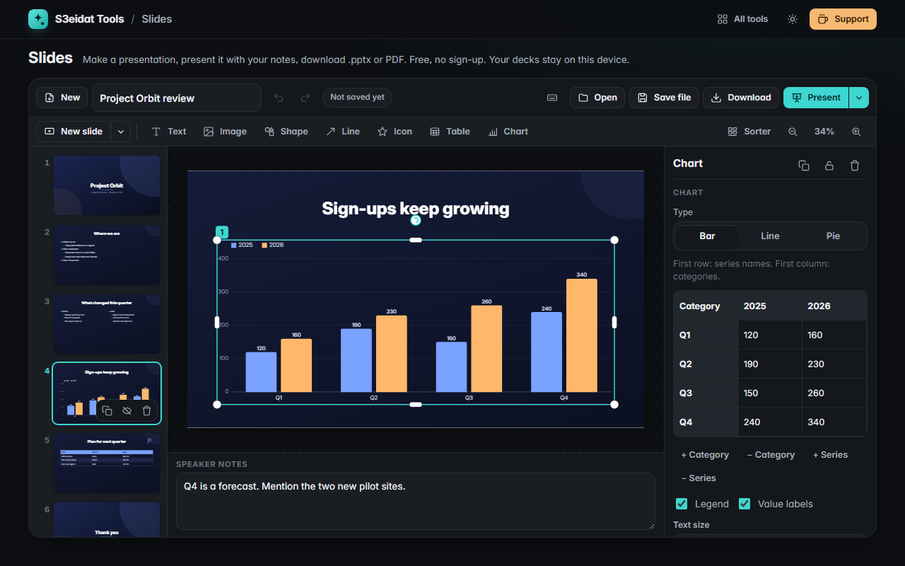

# Slides

> Make presentations, present them with a real presenter view, and download .pptx, PDF or PNG. Free, private, no sign-up, and it runs entirely in your browser.

### ▶ [Open Slides](https://s3eidat.github.io/slides/)



A free, local-first alternative to presentation apps like PowerPoint and Google Slides, for the everyday job: write a talk, give it, hand out the file.

## Features

- **9 original themes** (colours, fonts, backgrounds, decorations), including **Noor**, an Arabic-first **right-to-left** theme with mirrored layouts. Change the theme any time and every slide follows
- **16:9 and 4:3** slides, **8 layouts** with placeholders (title, title and content, two columns, section header, image and caption, title only, big number, blank), and a **sample outline** to start from
- **Text boxes** with **bullets and numbering in 5 levels** (Tab / Shift+Tab), shrink-to-fit or growing boxes, any font on your device, bold / italic / underline, alignment, line and paragraph spacing, Arabic and RTL text
- **Pictures** from your device (PNG, JPG, WebP, GIF and **SVG**), drop a picture on a placeholder to fill it
- **Shapes** (with text inside), **lines and arrows**, **74 icons** drawn for this project
- **Tables** with a header row and banded rows, edited in a grid
- **Charts**: bar, line and pie, drawn by our own renderer from an editable data grid
- **Filmstrip** with drag to reorder, **slide sorter**, duplicate, delete, **hide** slides; **speaker notes** under every slide
- **Transitions** (fade, slide in, push, zoom) and **entrance animations** (appear, fade, rise, fly in, zoom) with on-click / with-previous order
- **Present full screen**, from the start or from the current slide; arrows, Space, Page Up/Down and clickers; number + Enter to jump; **B / W** for a black or white screen
- **Presenter view**: current and next slide, notes with adjustable size, timer with pause/reset, clock, slide count, plus an **audience window** you drag to the projector
- Snapping guides, align / distribute, z-order, lock, rotation that never jumps away from 359°, undo / redo, zoom, keyboard shortcuts (press `?`)
- **Download .pptx** with editable text, bullets, shapes, lines, tables and speaker notes (backgrounds, icons and charts as pictures; hidden slides stay hidden), **PDF** (one page per slide, Latin text selectable) or **every slide as PNG** in a .zip
- **Autosave** in this browser (IndexedDB), a list of your presentations, and **.s3slides files** to back up or move a deck. Opened files are validated field by field

## Limits

- It does not open .pptx or other apps' files (export only).
- Transitions and animations are not written into the .pptx; charts go in as pictures, not editable charts.
- Fonts come from your device; another computer may substitute a missing font. Themes use widely installed fonts to keep that rare.
- No live collaboration, comments, cloud sync, video/audio or AI tools.
- The audience window needs pop-ups allowed for this page; going full screen in it takes one click inside it.

## Privacy

Your presentations, pictures and notes never leave your device. There is no server, no account and no analytics.
The page ships with a strict Content-Security-Policy (`connect-src 'self'`), so the browser itself blocks
any attempt to send data anywhere. Presentations are stored only in this browser until you save a file.

## Run it yourself

It's plain HTML, CSS and JavaScript with no build step:

```bash
git clone https://github.com/s3eidat/slides
cd slides
python -m http.server 8000
```

Then open http://localhost:8000. .pptx export uses [PptxGenJS](https://github.com/gitbrent/PptxGenJS) (MIT) and PDF export uses [pdf-lib](https://github.com/Hopding/pdf-lib) (MIT), both shipped in `lib/`.

## Support

If this saved you time, **[buy me a coffee ☕](https://s3eidat.github.io/coffee/)**. It keeps every tool free.

---

Part of **[S3eidat Tools](https://s3eidat.github.io/)**: 100+ free, private tools that run in your browser. MIT licensed.
